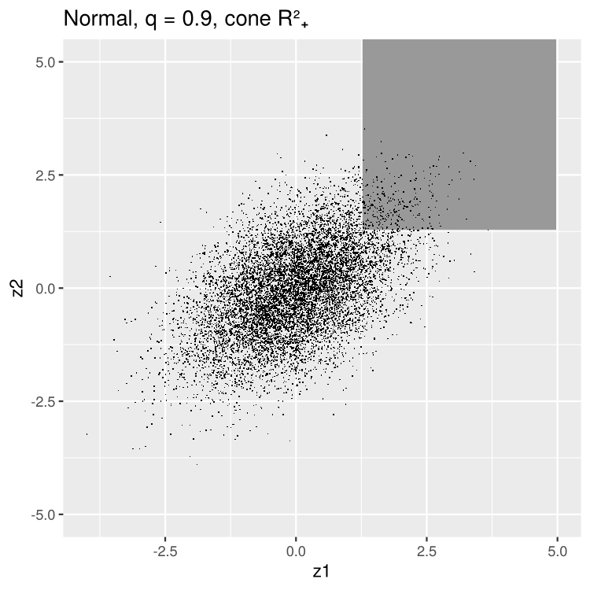
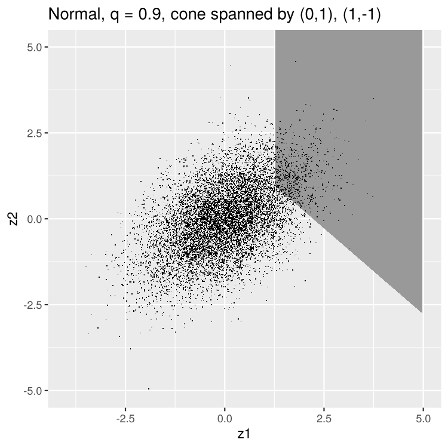
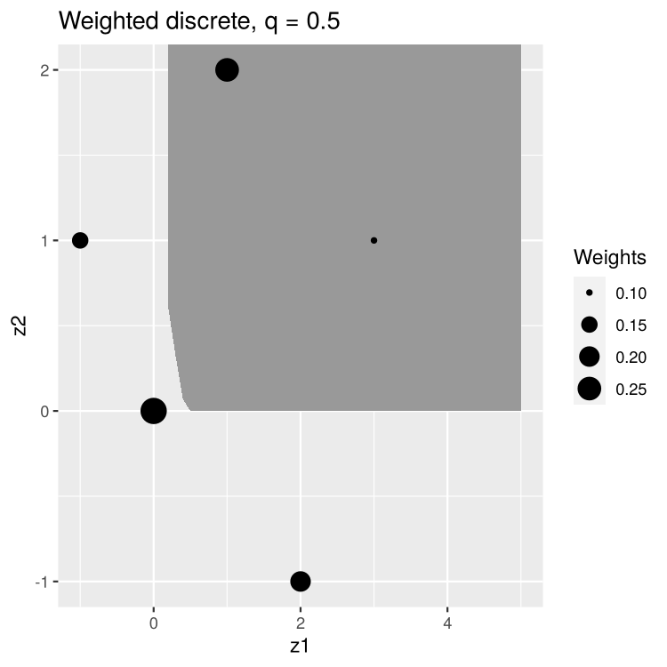
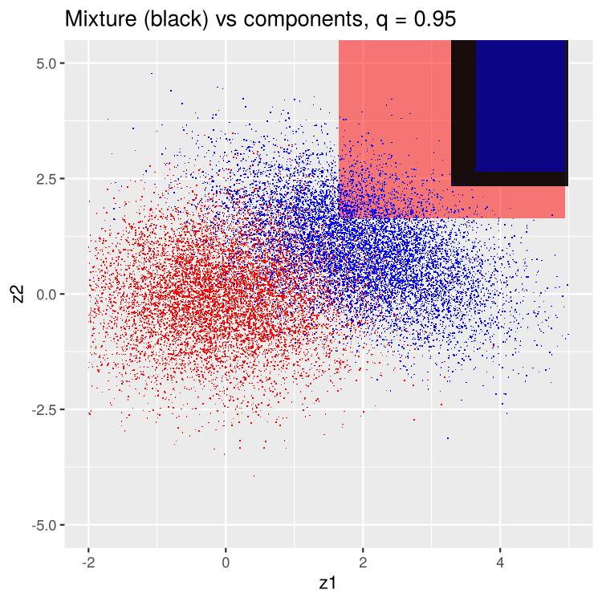

# Multidimensional Quantiles

R code from my MSc research project at Imperial College London on **quantiles of random vectors and elicitability**, supervised by Dr Tobias Fissler.

A univariate quantile is a number. For a random vector there is no natural ordering, so a quantile becomes a **set**. This repository computes and plots set-valued quantiles in two dimensions, for several families of distributions. It also explores two related ideas: β-Vorob'ev quantiles, and the convex level sets property, which is closely tied to elicitability.

---

## Background

### Cone quantiles

Let $X$ be a random vector in $\mathbb{R}^2$ and let $C$ be a convex cone with dual cone $C^+ = \lbrace w : w^\top c \ge 0 \text{ for all } c \in C\rbrace$. Following Hamel & Kostner (2018), the lower $C$-quantile at level $q \in (0,1)$ is the set

```math
Q_{X,C}(q) \;=\; \bigcap_{w \in C^+\setminus\lbrace 0\rbrace} \bigl\lbrace\, z \in \mathbb{R}^2 : w^\top z \;\ge\; q_{w^\top X}(q) \,\bigr\rbrace,
```

where $q_{w^\top X}(q)$ is the ordinary univariate $q$-quantile of the projection $w^\top X$. Each direction $w$ gives a half-plane, and the quantile region is their intersection. With the default cone $C = \mathbb{R}^2_+$, the dual cone is also $\mathbb{R}^2_+$.

The code builds $C^+$ from the edges of $C$. It discretises $C^+$ into 101 directions and computes $q_{w^\top X}(q)$ for each one, either exactly or from data. It then draws the intersection of the half-planes as a grey region, with a sample from the distribution plotted on top.

### β-Vorob'ev quantiles

If the direction $W$ is random instead of ranging over all of $C^+$, then $H_W = \lbrace z : W^\top z \ge q_{W^\top X}(q)\rbrace$ is a random half-plane. Its β-Vorob'ev quantile is the set of points covered with probability at least β:

```math
V_\beta \;=\; \lbrace \, z : \mathbb{P}(z \in H_W) \ge \beta \,\rbrace.
```

For β = 1 this recovers the intersection above. For β < 1 it gives a larger region that is less driven by extreme directions.

### Convex level sets and elicitability

A functional is elicitable if it minimises the expected value of some scoring function. A necessary condition is the **convex level sets (CxLS)** property: if $T(F_1) = T(F_2) = t$, then $T(\lambda F_1 + (1-\lambda) F_2) = t$ for all $\lambda \in [0,1]$. The `CxLS` scripts check this visually. They plot the quantile region of $F_1$ (red), of $F_2$ (blue) and of the mixture (black) on the same axes.

---

## Examples

The figures below were produced with `make_figures.R`. In each plot, the shaded area is the quantile region and the dots are a sample from the distribution.

<table>
<tr>
<td align="center"><br><sub>Bivariate normal (ρ = 0.5), q = 0.9, cone ℝ²₊</sub></td>
<td align="center"><br><sub>Same distribution, cone spanned by (0, 1) and (1, −1)</sub></td>
</tr>
<tr>
<td align="center"><br><sub>Weighted discrete distribution, q = 0.5</sub></td>
<td align="center"><br><sub>Two normals (red, blue) and their 50/50 mixture (black), q = 0.95</sub></td>
</tr>
</table>

To regenerate them, run the script from the repository folder:

```bash
Rscript make_figures.R
```

---

## Files

| File | Distribution | Main function |
|---|---|---|
| `mqnorm.R` | Bivariate normal $N(\mu, \Sigma)$, with exact projection quantiles | `mqnorm(q, mu, Sigma, C, Xlim, Ylim)` |
| `mqidunif.R` | Two independent uniforms on `Xlim` × `Ylim` | `mqidunif(q, Xlim, Ylim, C)` |
| `mqemp.R` | Empirical distribution of a sample `F` | `mqemp(q, F, C)` |
| `mqdis.R` | Discrete distribution on points `D` with weights `we` | `mqdis(q, D, we, C)` |
| `mqdis_uw.R` | Discrete distribution on points `D` with equal weights | `mqdis_uw(q, D, C)` |
| `CxLSprop.R` | Convex level sets experiments | `CxLSnorm`, `CxLSemp`, `mqnorm_3` |
| `beta-V-quantiles.R` | β-Vorob'ev quantiles for the bivariate normal | `mqnorm_rcone`, `mqnorm_rcone_notuni` |
| `make_figures.R` | Reproduces the example figures | — |

### Common arguments

- **`q`**: the quantile level, in (0, 1).
- **`C`**: the cone. Pass a matrix whose **rows** are vectors that generate the cone. The default `diag(2)` gives $\mathbb{R}^2_+$. For example, `C <- matrix(c(0, 1, 1, -1), byrow = TRUE, nrow = 2)` is the cone spanned by (0, 1) and (1, −1).
- **`mu`, `Sigma`**: the mean vector and covariance matrix, for the normal case.
- **`F`, `D`**: an n × 2 matrix of points.
- **`we`**: a vector of weights, one per point, that sums to 1. The default is equal weights.
- **`Xlim`, `Ylim`**: the plot range for `mqnorm`, and the support of the uniforms for `mqidunif`.

Every function returns a `ggplot` object, except the helper functions ending in `_2` inside `CxLSprop.R`. Those return the boundary of the region as a data frame with columns `x`, `ymin` and `ymax`.

### `CxLSprop.R`

- **`CxLSnorm(q, mu_1, Sigma_1, mu_2, Sigma_2, Lam, C)`**: plots the quantile regions of two normals and of their mixture $\lambda F_1 + (1-\lambda)F_2$. The mixture is represented by a weighted sample.
- **`CxLSemp(q, F_1, F_2, Lam, C)`**: does the same for two empirical distributions.
- **`mqnorm_3(...)`**: compares the regions of $X_1$, $X_2$ and the normal distribution of $\lambda X_1 + (1-\lambda) X_2$, with $X_1$ and $X_2$ independent.

### `beta-V-quantiles.R`

- **`mqnorm_rcone(q, b, mu, Sigma, C)`**: here `C = c(a0, a1)` is the **range of angles** for the direction $W$, and $W$ is uniform on that arc. `b` is the coverage level β. The region is evaluated on a 0.01 grid over [−5, 5]².
- **`mqnorm_rcone_notuni(q, mu, Sigma, C)`**: the same idea, but $W$ is not uniform. The first third of the arc gets twice the weight. Here β = q.

---

## Getting started

Install the required packages:

```r
install.packages(c("ggplot2", "MASS", "matrixStats", "Hmisc"))
```

| Package | Used for |
|---|---|
| `ggplot2` | All plots |
| `MASS` | `mvrnorm`, for sampling the normal distribution |
| `matrixStats` | `rowMins` and `rowMaxs` |
| `Hmisc` | `wtd.quantile`, for weighted quantiles in `mqdis` and `CxLSprop.R` |

Then load the packages and source the files:

```r
library(ggplot2); library(MASS); library(matrixStats); library(Hmisc)
source("mqnorm.R"); source("mqemp.R"); source("mqdis.R")
```

### Examples

```r
# Normal distribution, default cone R^2_+
mqnorm(0.5)
mqnorm(0.9, mu = c(1, 0), Sigma = matrix(c(1, 0.5, 0.5, 2), 2))

# A different cone
C <- matrix(c(0, 1, 1, -1), byrow = TRUE, nrow = 2)
mqnorm(0.9, C = C)

# Empirical distribution of a sample
X <- mvrnorm(500, mu = c(0, 0), Sigma = diag(2))
mqemp(0.8, X)

# Weighted discrete distribution
D  <- matrix(c(0, 0,  1, 2,  2, -1,  -1, 1), ncol = 2, byrow = TRUE)
mqdis(0.5, D, we = c(0.4, 0.3, 0.2, 0.1))

# Convex level sets: two normals and their mixture
# (define mu_1, Sig_1, mu_2, Sig_2 first: CxLSprop.R uses them when sourced)
mu_1 <- c(0, 0);  Sig_1 <- diag(2)
mu_2 <- c(2, 1);  Sig_2 <- matrix(c(1, -0.5, -0.5, 1), 2)
source("mqdis.R"); source("CxLSprop.R")
CxLSnorm(0.95, mu_1, Sig_1, mu_2, Sig_2, Lam = 0.5)

# beta-Vorob'ev quantile: directions uniform on [0, pi/2], beta = 0.8
source("beta-V-quantiles.R")
mqnorm_rcone(q = 0.5, b = 0.8)
```

---

## Notes

- Regions are computed and drawn inside the box [−5, 5]². Choose `mu` and `Sigma` so that the region of interest lies in this box.
- `CxLSprop.R` ends with example calls that use `mu_1`, `Sig_1`, `mu_2` and `Sig_2`. Define these before sourcing the file, or comment those lines out.
- `beta-V-quantiles.R` also ends with an example call, `mqnorm_rcone_notuni(0.9)`. Its functions loop over about one million grid points, so each call takes several seconds.
- The sampled points in the plots are for illustration only. In `mqnorm` and `mqidunif`, the regions use exact quantiles.

## Reference

A. H. Hamel and D. Kostner (2018). *Cone distribution functions and quantiles for multivariate random variables.* Journal of Multivariate Analysis, 167, 97–113. [arXiv:1611.06353](https://arxiv.org/abs/1611.06353)

## Author

Yuan Li, MSc Statistics, Imperial College London
